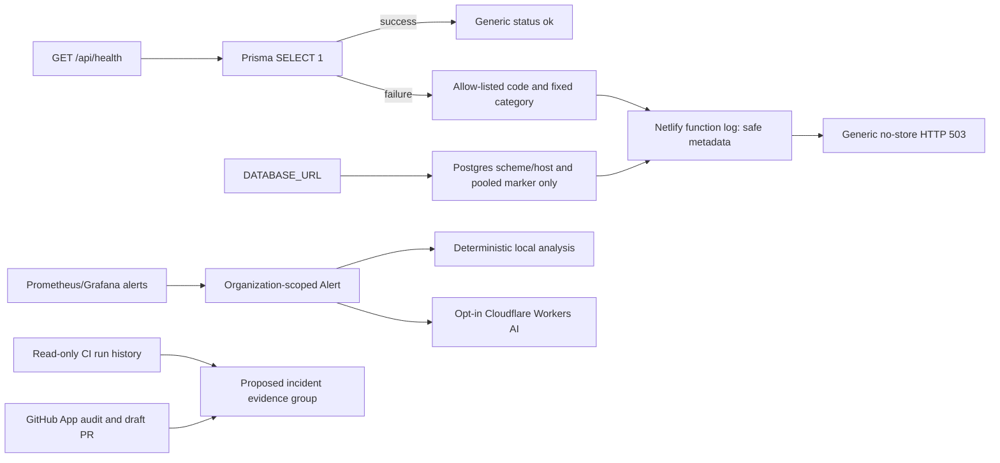

# System Design & Architecture

## Architecture Overview

The dotted roadmap item is future work only. This change updates the health route and documents future product design; it does not change the schema or create a unified incident record.

## Data Models

- **Current:** tenant-owned Alert and AnalysisResult records; monitoring source and CI/CD integration records; repository audit/repair data.
- **Current health:** no database fields are added. Failure logs use booleans for `databaseUrlConfigured`, `databaseUrlHasPostgresSchemeAndHost`, and `databaseUrlLooksPooled`, plus an optional allow-listed `errorCode` and fixed `errorCategory`.
- **Future, separate design:** incident/alert-group entity with organization, stable fingerprint, signal links, start/end times, status, and audit fields. Define deduplication, retention, and RLS before migration.

## API Design

`GET /api/health` keeps the existing API contract:

- Success: HTTP 200, `{"status":"ok"}`, `Cache-Control: no-store`.
- Database probe failure: HTTP 503, `{"status":"unavailable"}`, `Cache-Control: no-store`.
- Server log: only URL-shape booleans, a safe error name, an error code matching a fixed allowlist, and a fixed error category. Never include raw Prisma messages, URLs, hosts, query parameters, usernames, or passwords.

## Component Breakdown

- `src/app/api/health/route.ts`: safe URL-shape check, bounded cause traversal, code allowlist, fixed-category mapping, and generic response.
- `src/app/api/health/route.test.ts`: route behavior and non-disclosure tests.
- `docs/deploy-netlify.md`: operator steps for the separate Production and Deploy Preview variable contexts.
- `docs/competitive-landscape-2026-10-23.md`: official-source comparison and staged product roadmap.
- `docs/ai/*/README.md`: phase traceability for this bounded feature and future AI work.

## Design Decisions

- Do not expose diagnostics in the public response; logs are for the authenticated project owner.
- Classify only allow-listed codes or a small set of generic message patterns. Return a category label, never the source message.
- Normalize code tokens to uppercase before checking the allowlist.
- Describe URL shape precisely: the boolean means the value parses as a PostgreSQL URL with a host. It does not validate credentials, database existence, network access, or provider state.
- Detect `-pooler` only as a hint; it does not prove the URL belongs to the expected Neon project or branch.
- Keep incident grouping and OpenTelemetry ingestion as separate future milestones because they require schema, tenant-isolation, cardinality, retention, and cost decisions.

## Non-Functional Requirements

- No secret or customer connection details in logs or responses.
- No schema migration, provider setting mutation, outbound telemetry call, or change to deploy gates in this phase.
- Bounded `cause` traversal avoids unbounded exception chains.
- Additional log fields use fixed values and booleans for easy filtering without high-cardinality identifiers.
